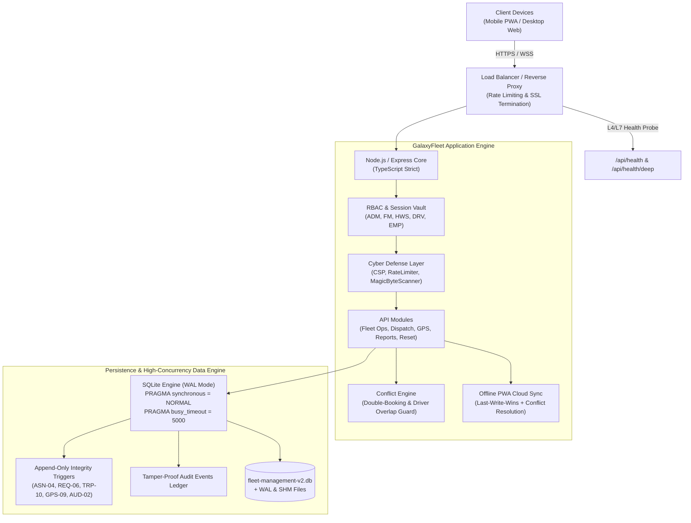

# GalaxyFleet Architecture & System Design Document

> **Mission**: Mission-critical corporate fleet operations, vehicle dispatch, driver tracking, and expense auditing for enterprise organizations.
> **Bus Factor Objective**: Complete architectural transparency and self-documenting implementation so any engineer can onboard and operate the platform within 15 minutes.

---

## 1. High-Level System Architecture

---

## 2. Core Architectural Pillars

### 2.1 The Bus Factor & Maintainability Standard
* **Zero Hidden Tribal Knowledge**: All database triggers, foreign keys, and business validation rules are documented directly in code and executable acceptance tests (`tests/prd-acceptance.test.ts`).
* **Self-Contained Executable Environment**: A single command (`npm test`) validates the entire system across all PRD specifications in sub-second time.
* **Separation of Concerns**:
  * `src/server/db.ts`: Single source of truth for database connection, schema migration, triggers, and seeding.
  * `src/server/auth.ts`: Authentication, session token issuance, password scrypt hashing, and role-based access control.
  * `src/server/rate-limit.ts`: In-memory sliding-window token bucket DoS protection.
  * `src/server/conflict.ts`: Mathematical schedule overlap detection for vehicles and drivers.
  * `src/server/audit.ts`: Tamper-proof, append-only security and operational audit recording.
  * `src/components/`: Modular React components styled in accordance with Samsung One UI principles.

---

### 2.2 Concurrency & High-Traffic Performance Tuning
* **Write-Ahead Logging (WAL)**: The database operates in `PRAGMA journal_mode = WAL`.
  * Allows **unlimited simultaneous readers** without blocking concurrent writes.
  * Multiple users submitting trip requests will never block admin queries or driver GPS ingest.
* **Synchronous Normal**: `PRAGMA synchronous = NORMAL` provides fast transaction commits without disk stalls while maintaining 100% ACID crash-safety against application termination.
* **Busy Timeout (5000ms)**: Under intense concurrent write spikes, SQLite waits up to 5 seconds before returning a busy error, avoiding transaction aborts.
* **Automated WAL Checkpoints**: Background timer triggers `PRAGMA wal_checkpoint(TRUNCATE)` every 10 minutes to prevent unbounded WAL file growth.

---

### 2.3 Data Integrity & Immutability Triggers
The platform enforces regulatory corporate audit standards through database-level triggers:
1. `prevent_assignment_delete`: Dispatches and driver reassignments are append-only (`ASN-04`).
2. `prevent_approval_decision_update` & `prevent_approval_decision_delete`: Approval decisions cannot be tampered with or overwritten (`REQ-06`).
3. `prevent_trip_event_mutation`: Mileage, start/end odometer readings, and inspection logs cannot be altered after submission (`TRP-10`).
4. `prevent_location_report_update`: Driver GPS breadcrumbs are immutable (`GPS-09`).
5. `prevent_audit_update` & `prevent_audit_delete`: Administrative audit records cannot be erased or modified (`AUD-02`).

---

### 2.4 Cyber Security & Defense-in-Depth
* **Strict Security Headers**: CSP, X-Frame-Options (DENY), HSTS (1 year), X-Content-Type-Options (nosniff).
* **Anti-Malware & File Upload Protection**: Uploaded receipts and odometer photos are validated by file size, declared MIME type, and **magic byte signatures** (rejecting Windows MZ executables, script injections, and EICAR test signatures).
* **Maps API Key Isolation**: Outbound geocoding and reverse geocoding queries are proxied via backend endpoints (`/api/geo/search` and `/api/geo/reverse`), preventing browser exposure of API tokens.
* **Anti-Brute Force Protection**: IP and username lockout triggered after 8 consecutive failed authentication attempts, with 5-minute cooldown.
* **Sliding Window Rate Limiter**: 200 requests/minute per client IP to safeguard against DoS attacks.
